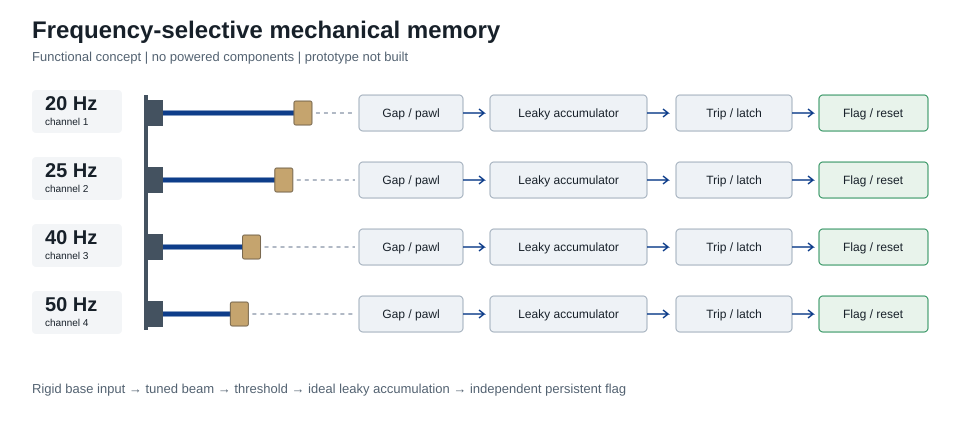
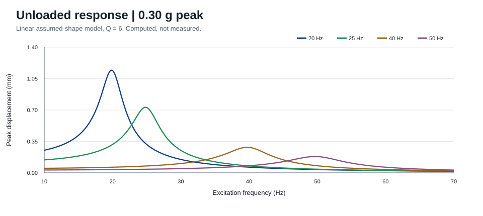

# REI Resonance Memory

**A battery-free, frequency-selective mechanical event recorder.**

An exploratory mechanical engineering project by Rootcastle Engineering & Innovation. The instrument is intended to attach to the stationary housing of a motor, pump or fan and retain a visible record of sustained vibration in selected frequency bands, without electrical power.

**Status: v0.1.0 — numerical research baseline. No hardware has been built or qualified.**

## The engineering question

Can a bank of tuned cantilevers drive a low-energy mechanical threshold, leaky accumulator and persistent latch with enough selectivity to distinguish sustained vibration from short shocks?

The proposed device has four independent, single-axis channels at 20, 25, 40 and 50 Hz. A first prototype should contain only the 25 Hz channel. These frequencies are examples, not universal machinery alarm thresholds.

## Working principle

1. A rigid base transfers housing acceleration into a spring–mass resonator.
2. Resonance amplifies relative displacement near the tuned frequency.
3. An adjustable gap rejects motion below the intended threshold.
4. A compliant pawl advances a spring-return accumulator. A separate dissipative mechanism allows the accumulator to return towards zero.
5. An over-centre or detent flag latches when the accumulator crosses its trip position. A manual reset clears the flag.

The flag is a proposed event indicator, not a calibrated spectrum analyser, vibration dosimeter, safety switch or fault classifier. The accumulator and pawl are not yet engineered to production geometry. The model assumes independent channels and zero sensing load on each resonator.

## Reproduce the calculations

Requires Python 3.10+; no third-party Python dependencies.

    python3 -m unittest discover -s tests -v
    python3 tools/generate.py
    python3 model.py --frequency 25 --acceleration-g 0.30

| Channel | Free length (mm) | Tip mass (g) | Nominal gap (mm) |
|---|---:|---:|---:|
| 20 Hz | 77.76 | 40 | 1.118 |
| 25 Hz | 67.11 | 40 | 0.715 |
| 40 Hz | 49.18 | 40 | 0.279 |
| 50 Hz | 42.43 | 40 | 0.179 |

All dimensions and predicted responses are nominal. The example uses E = 200 GPa, density = 7850 kg/m³, 12 × 0.8 mm strip section, Q = 6 and 0.30 g peak sinusoidal base acceleration. Values are calculated, not measured. See the [model derivation](docs/model.md) for the effective mass and base participation approximation.

## Explore

- [Engineering design and interfaces](docs/design.md)
- [Mathematical model and assumptions](docs/model.md)
- [Verification and laboratory protocol](docs/validation.md)
- [Prior art and reference provenance](docs/references.md)
- [Risk register](docs/risk.md)
- [Candidate bill of materials](hardware/bom.csv)
- [Editable OpenSCAD envelope](hardware/channel.scad)
- [Computed channel results](results/channels.csv)
- [Sensitivity cases](results/sensitivity.csv)
- [Executed verification evidence](docs/evidence.md)
- [Portfolio project brief](docs/portfolio.md)

## What is verified?

The checked-in software tests cover analytical consistency, resonator tuning, response bounds, transient integration and abstract memory behaviour. All experimental, durability, installation and safety gates remain open.

## Development roadmap

- **M0:** Reproducible unloaded numerical model and public design notes.
- **M1:** Guarded 25 Hz bench resonator; calibrate frequency and damping.
- **M2:** Measure force–displacement and energy losses of candidate pawl/accumulator. Demonstrate discrimination against short impulses.
- **M3:** Demonstrate flag retention, reset, repeatability and endurance.
- **M4:** Assess four-channel coupling, cross-axis sensitivity and environmental drift.

Contributions that add reproducible evidence are welcome. Do not publish confidential machine data, copied catalogue pages, supplier CAD or unlicensed material.

## License

MIT for original repository code, documentation and concept drawings. Third-party references are cited, not redistributed. The licence does not certify hardware safety, grant trademark rights, or establish freedom to operate. No patent novelty is claimed.

[Rootcastle Engineering & Innovation](https://rootcastle.com)
